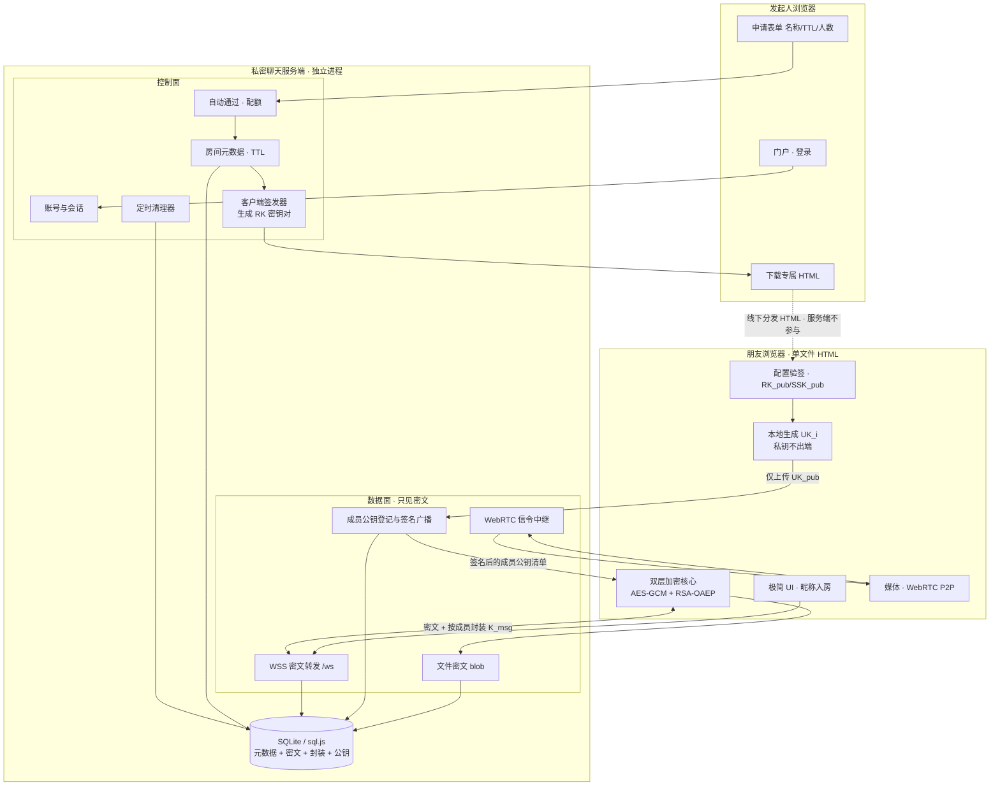
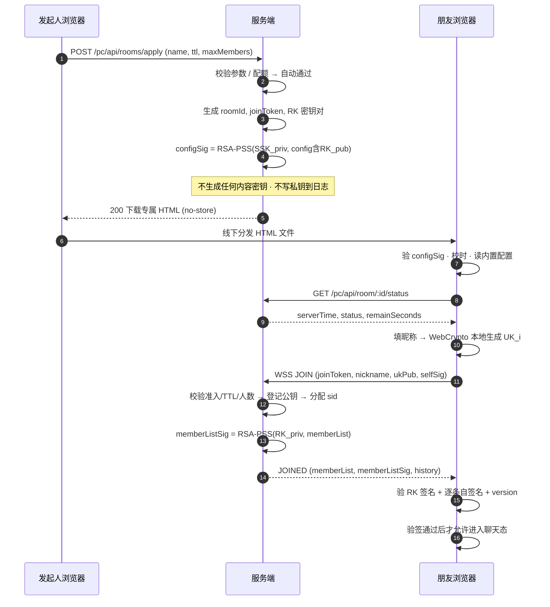
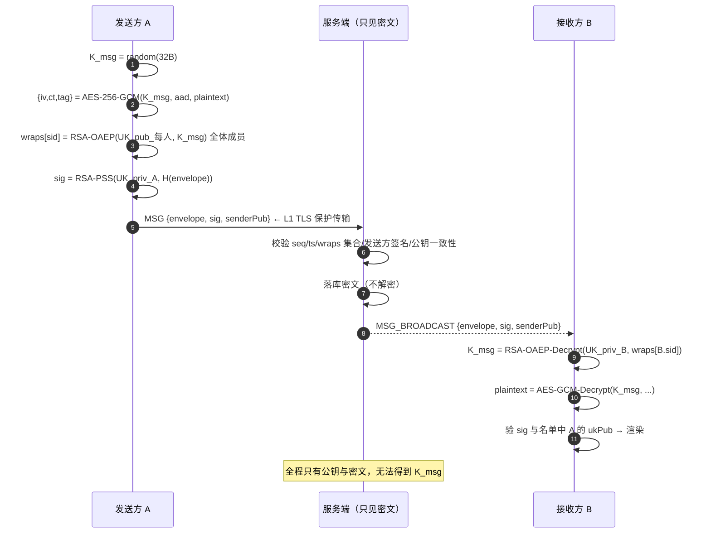
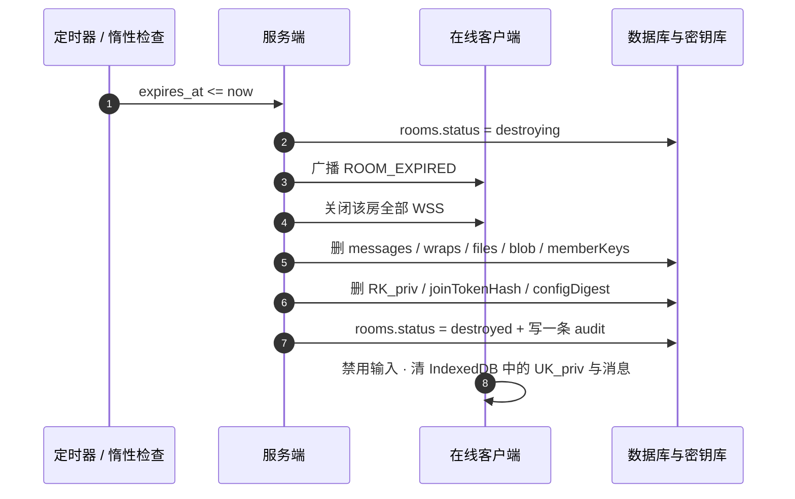
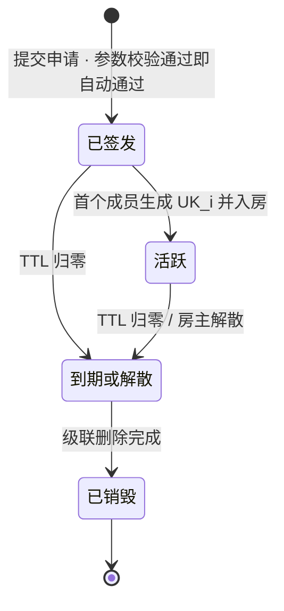

# 私密聊天 · 分支版本设计方案

> 版本：v0.2（**需求已冻结**，按用户第二轮加密细化重写）
> 日期：2026-11-16
> 上游文档：`docs/17-私密聊天-需求分析报告.md`（v0.2 冻结稿）
> 技术基线：主线 ChatRoom v5.4.0（`487bcd8`）
> 远程仓库：`https://gitee.com/klmycjs/private-chatroom.git` · 默认分支 `master`（已创建，初始提交 `802165f`）
> 本地路径：`D:/Pchatroom`
> 状态：本轮仍只产出规划文档；仓库初始化与文档推送在本轮完成，源码、构建、证书、部署留待 M1~M5

---

## 0 设计目标与原则

| 目标 | 设计取舍 |
|---|---|
| 朋友零门槛 | 所有连接信息塞进 HTML，首屏只留「昵称」一个输入框 |
| 房主可控 | 名称 / TTL / 人数在申请时确定，签发后不可静默变更 |
| 到期即消失 | 生命周期是一等公民，所有数据表带 `expires_at`，清理路径唯一 |
| **服务端零解密能力** | **聊天内容密钥只对持有本地私钥的成员可用；服务端全程只有公钥与密文** |
| 两层加密 | L1 = TLS 传输层；L2 = 应用层 E2EE（随机内容密钥 + 按成员公钥封装） |
| 隔离 | 独立仓库、独立进程、独立端口、独立数据目录、独立 systemd unit |
| 诚实的安全表述 | 只写「服务端不具备解密聊天内容的能力」，同时明示文件即凭证与公钥替换两类边界 |

**五条硬性原则**：
1. **准入凭证与加密材料分离**：`joinToken` 只用于认证（服务端存 HMAC、可吊销）；成员私钥与内容密钥永不上传、永不落服务端。
2. **私钥绝不离端**：`UK_priv_i`、`K_msg`、`K_file` 只存在于成员浏览器本地；`RK_priv` / `SSK_priv` 只在服务端密钥库。
3. **公钥必须可信**：内置 `RK_pub` / `SSK_pub` 均纳入配置签名；成员公钥清单必须带 RK 签名 + 成员自签名，否则拒绝使用。
4. **配置块必须签名**：任何内置字段被改动，客户端验签失败即拒绝连接。
5. **明文密钥不落盘、不写日志、不进错误上报**：签发响应里也不包含任何内容密钥（本版已无对称房间密钥）。

---

## 1 总体架构



**分层职责**

| 层 | 职责 | 明确不负责 |
|---|---|---|
| 门户 / 控制面 | 账号、申请、自动通过、配额、房间元数据、生成 RK 密钥对、客户端签发、生命周期 | 转发消息、接触媒体、**持有任何成员私钥或内容密钥** |
| 数据面 | WSS 密文转发、成员公钥登记与可信广播、信令中继、密文文件收发 | **解密业务内容**、审批、签发 |
| 客户端 | 验签、生成 `UK_i`、加密/封装/解密/验签、极简 UI、导出、媒体 | 账号、房间管理、上传私钥 |

控制面与数据面共用同一份房间状态；只有控制面能写 `rooms` 表，数据面只读状态并做惰性过期检查。

---

## 2 独立新仓库与代码组织（Q-01 已决）

| 项 | 结论 |
|---|---|
| 远程仓库 | `https://gitee.com/klmycjs/private-chatroom.git`，默认分支 **`master`**（注意：主线是 `main`） |
| 远程状态 | 用户 2026-11-16 已创建，`git ls-remote` 验证连通，已有初始提交 `802165f`（Gitee 初始化文件） |
| 本地路径 | `D:/Pchatroom`【默认采纳】 |
| 首次动作 | `git clone` 远程 → 建立 `docs/` 并提交四份规划文档 → 推送 `master`（本轮完成） |
| 隔离级别 | 独立仓库 + 独立进程 + 独立端口 + 独立数据目录 + 独立 systemd unit；**不改动主线线上服务** |
| 版本标识 | `PC_RELEASE_VERSION = 0.1.0`，与主线 `RELEASE_VERSION = 5.4.0` 完全独立，`/pc/api/health` 单独上报 |

### 2.1 目录结构

```text
private-chatroom/
  docs/                              # 本轮四份规划文档（从主仓 docs/ 迁入）
    17-私密聊天-需求分析报告.md
    18-私密聊天-设计方案.md
    私密聊天-需求思维导图.xmind
    私密聊天-系统框图.html
  README.md                          # 独立撰写安全说明，禁止复制主线 KDC 措辞
  shared/protocol.js                 # 独立 PC_* 协议常量（PC_PROTOCOL_VERSION = 1）
  vendor/forge.min.js                # 从主仓复制，标注来源 commit 487bcd8
  server/
    src/{main,http,hub,rooms,accounts,issuer,keys,expiry,files,protocol}.js
    public/                          # 门户页、客户端模板
    admin/                           # 房间总览 · 配额 · 强制销毁（无申请队列）
    deploy/private-chat.service      # 独立 systemd unit
  client/
    src/{template.html,style.css,config.js,crypto.js,members.js,net.js,app.js,export.js,media.js}
    dist/private-chat.template.html  # 配置块留 __PC_CONFIG__ 占位符
  tools/{build-client.js,package-server.js,smoke-pc.js,verify-pc-crypto.js}
  dist/                              # 部署包产物
```

### 2.2 从主仓复制的清单与同步约束（对应 R-12 / T-13）

| 复制项 | 来源 | 处理方式 |
|---|---|---|
| `vendor/forge.min.js` | 主仓 `487bcd8` | 原样复制，文件头加 `SOURCE: klmycjs/chatroom@487bcd8` 注释 |
| `tools/build-client.js` 占位符机制 | 主仓 | 改造：`__CSS__/__PROTOCOL__/__FORGE__/__CRYPTO__/__NET__/__APP__` 保留，新增 `__PC_CONFIG__` |
| `server/src/http.js` 的 HTTPS / 静态 / 文件端点 | 主仓 | 裁剪改造，去掉主线 `/api/*` 与 `/download/*` |
| `server/src/hub.js` 的房间成员管理与信令转发 | 主仓 | 裁剪改造，去掉大厅/私聊/身份链/机器人/邀请码 |
| `server/src/database.js` / `files.js` | 主仓 | 复用框架，新建独立表结构 |
| 主线 UI（登录页、身份库、背景主题、多房间标签） | 主仓 | **不复制**，本版极简重写 |
| 主线 `client/src/crypto.js` | 主仓 | **不复制**：主线是 KDC 房间密钥模型，与本版逐成员密钥封装模型不同，必须重写 |

> **同步纪律**：在 `docs/` 或 README 维护「复制清单与来源 commit」；主线后续若有加密相关修复，评审时须检查本仓是否需要同步。两个仓库不建立 git subtree/submodule，避免耦合。

---

## 3 模块设计

### 3.1 账号与会话（`accounts.js`）

- 注册：`username`（3–32，大小写不敏感）+ 口令，`argon2id` 或 Node `crypto.scrypt` 加盐 hash。
- 会话：随机 `sid`（32B）→ HttpOnly + Secure + SameSite=Lax Cookie，`sessions` 表 TTL 7 天。
- 限流：登录失败按 IP + 用户名计数，5 次/10 分钟锁定。
- 配额：每人同时活跃房间数默认 3（可配置），申请时检查。
- **不使用主线的管理员非对称登录**：那是运维通道，不是个人账号体系。

### 3.2 申请与自动通过（`rooms.js`）

```text
POST /pc/api/rooms/apply
  → 校验会话
  → 校验 name（1–40 字符、去首尾空白、敏感词表、文件名清洗）
  → 校验 ttlSeconds：未提供 → 86400；范围 (0, 259200]
  → 校验 maxMembers：范围 [2, SERVER_HARD_MAX]（默认 6，硬上限 20）
  → 检查个人配额
  → ★ 参数通过即自动置于 issued（Q-03），同一事务内完成签发
  → 生成 roomId(16B)、joinToken(32B)、RK 房间身份密钥对
  → expires_at = issued_at + ttlSeconds（Q-04，从签发时刻起算，不续期）
  → 写 audit(event=room_issued, room_id)
  → 返回 roomId、expiresAt、下载链接
```

`pending` 状态只存在于该事务内，不落库、不产生可见申请队列；管理台因此**不需要审批面板**。管理员仍保留强制销毁、配额调整与凭证吊销。

### 3.3 客户端签发器（`issuer.js`）— 本版核心，已按新加密模型重写

```text
1. CSPRNG：roomId(16B)、joinToken(32B)
2. 生成 RK 房间身份密钥对（RSA-2048/3072）
     RK_pub  → 写入每份该房 HTML 的配置块
     RK_priv → 只存服务端密钥库（每房一对，房间销毁即删）
3. 组装配置块 config = {
     v, serverUrl, roomUrl, roomId, name,
     joinToken,                      // 仅准入
     roomPubKey:  RK_pub,            // 验成员公钥清单签名
     serverPubKey: SSK_pub,          // 验配置签名（平台签发公钥）
     issuedAt, expiresAt, maxMembers,
     clientVersion
   }
   ★ 不含 roomKey、不含任何私钥、不含任何对称内容密钥
4. configSig = RSA-PSS-SHA256(SSK_priv, canonicalJSON(config))
   （按 key 字典序序列化；RK_pub 与 joinToken 均在被签名字段内，防止被替换）
5. 读模板 private-chat.template.html（进程启动时载入内存）
6. 把 __PC_CONFIG__ 替换为
     window.__PC_CONFIG__ = <json>; window.__PC_CONFIG_SIG__ = "<b64>";
   沿用主线 safeJs() 做 "</script" 转义与文件名清洗
7. 数据库仅写：joinTokenHash、configDigest、RK_pub、RK_priv 引用、issuedAt、expiresAt
   ★ 不写 joinToken 明文、不写任何私钥明文到普通表/日志/临时文件
8. 一次性响应：
   Content-Type: text/html; charset=utf-8
   Content-Disposition: attachment; filename="private-chat-<name>-<短id>.html"
   Cache-Control: no-store, private
```

**与 v0.1 的根本差异**：v0.1 在这一步生成 `roomKey`（对称房间密钥）并内置进 HTML；v0.2 **不再生成任何内容密钥**，内置的是两把**公钥**。`K_msg` / `K_file` 由各成员浏览器在发消息/文件时即时生成。

**重新签发**：旧 `joinTokenHash` 与旧 `RK_priv` 立即失效，生成新的 `joinToken` 与新的 RK 密钥对，旧 HTML 无法入房。`rooms.sig_count` 记录签发次数。

**`configDigest`**：`SHA-256(canonicalJSON(config) + configSig)`，只用于识别客户端版本，不可逆、不可推导任何密钥。

### 3.4 成员公钥登记与可信广播（`keys.js`）— 新增模块，对应 T-11

```text
C → S  JOIN {roomId, joinToken, nickname, ukPub, selfSig, clientTime, nonce}
        selfSig = RSA-PSS-SHA256(UK_priv_i, canonical({roomId, ukPub, nickname, clientTime}))
S      校验 joinTokenHash / 状态 / TTL / 人数上限 / 昵称 / 帧大小
S      分配 sessionId，把 {sid, nickname, ukPub, selfSig} 写入内存态 memberKeys
S      组装 memberList = {version, roomId, members:[{sid, nickname, ukPub, selfSig}]}
S      memberListSig = RSA-PSS-SHA256(RK_priv, canonicalJSON(memberList))
S → C  JOINED {sessionId, serverTime, expiresAt, memberList, memberListSig, history[]}
S → *  MEMBER_KEYS {memberList, memberListSig}   // 每次成员变动广播，version 递增
C      验 memberListSig（用内置 RK_pub）
       + 验每条 selfSig（用该条自身的 ukPub）
       + 检查 version 单调递增（防重放旧名单）
       → 任一失败：拒绝更新本地密钥表并提示「成员身份校验失败」
```

**三重防替换**：① 清单 RK 签名；② 每条公钥自签名；③ `RK_pub` 本身被 `configSig` 绑定。此外可选在成员列表旁展示**安全码**（全体公钥指纹的短哈希）供线下比对。

> 若 Q-15 选择「`RK_priv` 由房主浏览器本地生成保管」，则服务端根本无法伪造清单签名，T-11 被彻底消除；代价是签发流程需房主浏览器参与、房主丢失私钥则无法再签发名单。默认仍按「服务端保管」实现，并以 ①②③ 缓解。

### 3.5 房间生命周期管理器（`expiry.js`）

- **持久化**：`rooms.expires_at` 落库；进程重启后启动扫描，把 `expires_at <= now` 且未销毁的房间推入清理队列，避免「永生房间」。
- **双重检查**：定时器（每分钟）扫描 + 每次准入 / 每条消息 / 每次文件上传时惰性检查。
- **销毁序列**（幂等、事务化）：
  ```
  标记 status=destroying → 广播 ROOM_EXPIRED → 关闭该房全部 WSS
  → 删 messages(密文 + wraps) → 删 files(blob + 记录)
  → 清 memberKeys 内存态 → 删 RK_priv / RK_pub / joinTokenHash / configDigest
  → 标记 status=destroyed → 写一条 audit（只记 roomId 与事件）
  ```
- **房主提前解散 / 踢人**：解散复用同一序列；踢人则从 `memberKeys` 移除该 sid 并广播新版本清单，后续消息的 `wraps` 不再包含该 sid（前向保密，见 7.7）。
- **客户端本地**：收到 `ROOM_EXPIRED` 后禁用输入、清除 IndexedDB/localStorage 中的消息、`K_msg`、`K_file` 与 `UK_priv_i`。朋友本地 HTML 副本无法由服务端删除，UI 需明确提示。

### 3.6 数据面（`hub.js` / `http.js`）

- WSS 路径沿用 `/ws`，使用独立 `PC_*` 协议常量，握手后第一条必须是 `JOIN`。
- 消息处理只做：**结构校验 → 准入/状态/TTL/人数 → `seq` 递增与 `ts` 容差 → `wraps` 成员集合一致性 → 用登记的 `UK_pub` 验发送方签名 → 存密文 → 转发**。**从不解密、不尝试解密**。
- `wraps` 的 key 集合必须等于当前 `memberKeys` 的 sid 集合；缺任一成员则拒绝（`E_WRAP_INCOMPLETE`），防止发送方故意不给某人封装。
- WebRTC 信令：沿用主线房间成员校验 + 转发模式；推荐把信令载荷按目标成员 `UK_pub` 做一次 RSA-OAEP 封装，避免服务端读到 SDP 中的 IP/拓扑。媒体 P2P DTLS-SRTP 天然 E2EE。
- 文件上传：密文 blob 存取，请求带 `sessionId` 与 `roomId`，落库写 `expires_at` 参与级联删除。

### 3.7 客户端模块

| 模块 | 职责 |
|---|---|
| `config.js`【新增】 | 读 `__PC_CONFIG__` / `__PC_CONFIG_SIG__`；canonical JSON；用 `SSK_pub` 验签；用 `/status` 的 `serverTime` 校正本机偏移；校验 `expiresAt`；失败不发起任何连接 |
| `crypto.js`【重写】 | WebCrypto 生成 `UK_i`；`K_msg`/`K_file` 随机 32B；AES-256-GCM（12B IV + 16B tag）；RSA-OAEP 按成员封装；RSA-PSS 消息签名与验签；**不实现任何共享房间密钥** |
| `members.js`【新增】 | 维护验签通过的成员公钥表；处理 `MEMBER_KEYS` 版本、RK 签名与逐条自签名校验；生成/展示安全码 |
| `net.js` | WSS 连接、心跳、指数退避重连、`JOIN`/`JOINED`、断线后复用同一 `UK_i` 重新入房 |
| `app.js` | 极简 UI 状态机：`自检 → 昵称输入 → 生成 UK_i → 聊天`；成员列表、消息渲染、倒计时 |
| `export.js`【新增】 | 本地明文导出 JSON / TXT / HTML；`Blob` + `createObjectURL` 下载；导出前明文风险提示；可选加密导出 |
| `media.js` | 语音条、mesh 视频网格、文件拖拽 |

**UI 结构（极简）**：
```text
┌──────────────────────────────────────────┐
│ 房间名   剩余 23:41:07   3/6 人   [成员] │  ← 顶栏
├───────────────────────────────┬──────────┤
│                               │  在线成员 │
│         消息区                 │  · 我 ✓  │
│                               │  · 阿明 ✓ │
│                               │  · 小雨 ✓ │
├───────────────────────────────┴──────────┤
│ [附件] [语音] [视频] [导出]  [ 输入框 ] [发送] │
└──────────────────────────────────────────┘
```
无登录页、无房间列表、无身份管理、无设置面板；说明性文字一律收进控件 `title`。成员名后的 ✓ 表示公钥已通过验签（可选显示）。

---

## 4 数据模型

| 表 / 状态 | 主要字段 | 说明 |
|---|---|---|
| `users` | `id`, `username`, `password_hash`, `salt`, `created_at`, `quota_rooms` | 个人账号 |
| `sessions` | `sid`, `user_id`, `expires_at` | 门户会话 |
| `rooms` | `id`, `owner_id`, `name`, `status`, `ttl_seconds`, `max_members`, `created_at`, `issued_at`, `expires_at`, `join_token_hash`, `config_digest`, `room_pub_key`, `room_priv_key_ref`, `sig_count`, `revoke_at` | **不含任何内容密钥、不含 joinToken 明文** |
| `messages` | `room_id`, `seq`, `sender_session`, `ts`, `kind`, `iv`, `ct`, `tag`, `wraps_json`, `sender_pub`, `sig`, `expires_at` | 仅密文 + 每成员一份的密钥封装；`room_id` / `expires_at` 级联删除 |
| `files` | `id`, `room_id`, `size`, `iv`, `ct`, `tag`, `blob_path`, `expires_at` | 密文 blob；文件名/类型/大小也加密后存 `ct` |
| `audit` | `id`, `event`, `room_id`, `ts` | 只记事件，不含昵称/内容/凭证 |
| 服务端密钥库 | `SSK_priv`（平台级）、每房 `RK_priv` | 独立于业务库的文件或加密存储；房间销毁即删该房 `RK_priv` |
| 内存态 | `memberKeys`: `sessionId → {nickname, ukPub, selfSig, joinedAt, ws}` | 不落盘，进程重启即空；清单 `version` 单调递增 |
| 客户端本地 | `UK_priv_i`（IndexedDB，会话内复用）、消息明文缓存 | **永不上传**；到期/退出清除 |

**索引**：`rooms(expires_at, status)` 供定时扫描；`messages(room_id, seq)` 供同期成员重连补拉；`files(room_id, expires_at)` 供级联删除。

**关键约束**：数据库备份、日志、错误上报中不得出现 `joinToken` 明文、任何私钥、`K_msg` / `K_file` 或消息明文。

---

## 5 接口设计

### 5.1 HTTP（控制面）

| 方法 | 路径 | 说明 | 认证 |
|---|---|---|---|
| POST | `/pc/api/auth/register` | 注册 | 无 |
| POST | `/pc/api/auth/login` | 登录 | 无 |
| POST | `/pc/api/auth/logout` | 登出 | 会话 |
| GET | `/pc/api/rooms` | 我的房间列表（状态、剩余时间、成员数） | 会话 |
| POST | `/pc/api/rooms/apply` | 申请 → **自动通过 → 立即签发** | 会话 |
| GET | `/pc/api/rooms/:id/client` | 下载专属 HTML（签发 / 重新签发） | 会话 + owner 校验 |
| POST | `/pc/api/rooms/:id/dissolve` | 提前解散 | 会话 + owner |
| POST | `/pc/api/rooms/:id/revoke` | 吊销当前凭证 | 会话 + owner |
| GET | `/pc/api/room/:id/status` | 客户端自检：`serverTime`、`status`、`remainSeconds` | 无需会话，仅非敏感信息 |
| POST | `/pc/api/file/upload` | 密文文件上传 | `sessionId` + `roomId` |
| GET | `/pc/api/file/get` | 密文文件下载 | `sessionId` + `roomId` |
| GET | `/pc/api/health` | 健康检查（`pcVersion`、活跃房间数、待清理数） | 无 |
| POST | `/pc/api/admin/rooms/:id/destroy` | 强制销毁 | 管理员 |
| GET | `/pc/p/:roomId` | **在线 HTTPS 入口**（备选，返回同份内联配置 HTML） | URL 一次性 token |

> 去掉了 v0.1 的 `/pc/api/admin/rooms/:id/approve`（Q-03 自动通过）。`/pc` 前缀保留作为内部命名空间，虽已独立进程部署但便于未来与主线共存或反向代理分流。

### 5.2 WebSocket（数据面 `/ws`）

| 方向 | 类型 | 载荷 |
|---|---|---|
| C→S | `JOIN` | `{roomId, joinToken, nickname, ukPub, selfSig, clientTime, nonce}` |
| S→C | `JOINED` | `{sessionId, serverTime, expiresAt, memberList, memberListSig, history[]}`（history 为密文，仅同期成员可解） |
| S→C | `MEMBER_KEYS` | `{memberList, memberListSig, version}`（成员变动时广播） |
| C→S | `MSG` | `{envelope, sig, senderPub}`，`envelope = {v, roomId, senderSid, seq, ts, kind, iv, ct, tag, wraps, meta}` |
| S→C | `MSG_BROADCAST` | 同上 + `fromSession` |
| C→S / S→C | `RTC_SIGNAL` | `{to, encryptedSignal}`（推荐按目标 `UK_pub` 封装，服务端只见密文） |
| S→C | `ROOM_EXPIRED` | 到期 / 解散通知 |
| S→C | `ERROR` | `{code}`：`E_ROOM_INVALID` / `E_ROOM_FULL` / `E_REPLAY` / `E_RATE_LIMIT` / `E_SIG_INVALID` / `E_WRAP_INCOMPLETE` / `E_KEY_INVALID` |
| 双向 | `PING` / `PONG` | 心跳 |

**错误码刻意不细分「房间不存在 / 已到期 / 凭证错」**，统一 `E_ROOM_INVALID`，防枚举。

---

## 6 加密与密钥方案（核心章节，按用户第二轮细化重写）

### 6.1 密钥清单与归属

| 名称 | 类型 | 生成方 / 时机 | 存放位置 | 用途 | 服务端能否用于解密 |
|---|---|---|---|---|---|
| `SSK` | RSA-2048 平台签发密钥对 | 服务端部署时一次性生成 | `SSK_priv` 服务端密钥库；`SSK_pub` 内置每份 HTML | 对 canonical 配置签名 `configSig` | 否（签名密钥） |
| `RK` | RSA-2048 **房间身份密钥对** | **房间建立（自动通过）时由签发器生成** | `RK_priv` 服务端密钥库（每房一对）；`RK_pub` **内置该房 HTML** | 对成员公钥清单签名 `memberListSig` | 否（签名密钥） |
| `UK_i` | RSA-2048 **成员密钥对** | **每个成员填昵称点「进入」时，浏览器 WebCrypto 本地生成** | `UK_priv_i` **仅本地 IndexedDB**；`UK_pub_i` 上传服务端并广播 | 封装 `K_msg` / `K_file`；消息签名 | **否，服务端只有公钥** |
| `K_msg` | AES-256 随机 32B | 发送方**每条消息**即时生成 | 本地内存，发完即弃 | 加密消息内容 | **否** |
| `K_file` | AES-256 随机 32B | 发送方**每个文件**即时生成 | 本地内存 | 加密文件内容 | **否** |
| `joinToken` | 32B CSPRNG | 签发时 | 内置 HTML；服务端只存 `HMAC(serverSecret, joinToken)` | **仅准入认证** | 不适用 |

**为什么是两对服务端密钥**：`SSK` 是平台长期密钥，负责绑定「这份 HTML 的配置」；`RK` 是每房临时密钥，负责绑定「这个房间的成员公钥」，房间销毁即删除 `RK_priv`，历史名单签名不可再伪造。二者都是**签名密钥**，不是解密密钥，因此服务端持有它们**不构成解密能力**。若 Q-15 选房主本地保管 `RK_priv`，则服务端连伪造名单的能力也没有。

**房间公钥 `RK_pub` 的确切用途（对 BR-20a 的必要补全）**：
1. 验证服务端下发的**成员公钥清单**签名（防偷换公钥，T-11）；
2. 验证房间公告中的房间身份字段；
3. **不用于加密聊天内容** —— 朋友只持有公钥，若用它加密内容，则无任何客户端持有对应私钥可解密。这是本方案对用户原话唯一的一处技术性补全。

### 6.2 两层加密的准确定义

| 层 | 名称 | 算法 | 谁终止 | 服务端可见 |
|---|---|---|---|---|
| **L1** | 传输层 | TLS 1.3（HTTPS / WSS，公网可信证书） | 服务端 | 应用层密文帧 |
| **L2** | 应用层内容加密 | `AES-256-GCM(K_msg, iv, aad, plaintext)` | 各成员浏览器 | `iv / ct / tag` |
| **L2-key** | 应用层密钥封装 | `RSA-OAEP-SHA256(UK_pub_i, K_msg)`，每个成员一份 | 各成员浏览器 | 每成员一份密文封装 `wraps[sid]`，**无法解开** |
| 身份 | 消息签名 | `RSA-PSS-SHA256(UK_priv_sender, H(canonical(envelope)))` | 任何人可验 | 签名（可验不可伪造） |

> 「服务器加密只保证数据传输安全」对应 L1；L2 的密钥完全在各成员浏览器本地产生与销毁。服务端从房间建立到销毁，**全程不持有任何可解密聊天内容的私钥或对称密钥** —— 这是与主线 KDC 模型、以及 v0.1 的 B 档（签发瞬间见过 `roomKey`）的本质区别。

### 6.3 单条消息的完整协议

**发送方 S**（`memberKeys` 为已验签的当前成员表，含自己）：

```text
K_msg = crypto.getRandomValues(new Uint8Array(32))
iv    = random 12B
aad   = roomId + "|" + senderSid + "|" + seq + "|" + serverTs + "|" + kind
{ct, tag} = AES-256-GCM-Encrypt(K_msg, iv, aad, plaintext)

wraps = {}
for each (sid, ukPub) in memberKeys:
    wraps[sid] = RSA-OAEP-SHA256-Encrypt(ukPub, K_msg)   // 含自己，便于本地历史回读

envelope = {v, roomId, senderSid, seq, ts, kind, iv, ct, tag, wraps, meta}
sig      = RSA-PSS-SHA256(UK_priv_S, SHA-256(canonicalJSON(envelope)))
frame    = {type:"MSG", envelope, sig, senderPub: UK_pub_S}
```

**服务端**（`hub.js`）：

```text
校验：joinToken 已绑定该 session / 房间状态 / expires_at / 人数 / 帧大小
     seq 严格递增 / ts 在服务端时间容差内（客户端时间用 serverTime 校正）
     set(wraps.keys) == set(memberKeys.keys)        否则 E_WRAP_INCOMPLETE
     RSA-PSS-Verify(senderPub, sig, envelope)        否则 E_SIG_INVALID
     senderPub == memberKeys[senderSid].ukPub        否则 E_KEY_INVALID（防自带假公钥）
落库：存 envelope / sig / senderPub（仅密文）
转发：MSG_BROADCAST 给全体成员
★ 服务端只有 UK_pub 与密文封装，无法得到 K_msg，无法得到 plaintext
```

**接收方 i**：

```text
W      = envelope.wraps[mySid]                      // 缺失 → 提示「本条消息未向我封装」
K_msg  = RSA-OAEP-Decrypt(UK_priv_i, W)
plaintext = AES-256-GCM-Decrypt(K_msg, iv, aad, ct, tag)
RSA-PSS-Verify(senderPub, sig, envelope)            // 并核对 senderPub 与已验签名单一致
渲染
```

**`wraps` 必须包含全体当前成员**：既保证每人可读，也让服务端能检测「故意排除某人」的行为；成员退出后其 sid 从清单移除，后续 `wraps` 不再包含它 → 旧私钥失去作用（前向保密）。

### 6.4 成员公钥的可信分发（T-11 的核心缓解）

```text
1. 客户端生成 UK_i 后，先自签名：
     selfSig = RSA-PSS(UK_priv_i, canonical({roomId, ukPub, nickname, clientTime}))
2. JOIN 上传 {ukPub, selfSig}，服务端登记并分配 sid
3. 服务端用 RK_priv 对完整清单签名（含 version，单调递增）
4. 客户端三重校验：
     ① RSA-PSS-Verify(RK_pub, memberListSig, memberList)
     ② 每条 RSA-PSS-Verify(ukPub, selfSig, 该条内容)
     ③ version 严格递增，拒绝旧清单重放
   任一失败 → 拒绝更新密钥表、禁用发送、提示「成员身份校验失败」
5. 可选：成员列表旁展示安全码 = SHA-256(全体 ukPub 排序拼接) 的前 8 位，供线下比对
```

此外 `RK_pub` 与 `SSK_pub` 本身都在 `configSig` 的被签名字段内，替换公钥会导致启动验签失败（T-03）。

### 6.5 文件 / 语音 / 视频 / 导出

| 类型 | 处理 |
|---|---|
| **文件** | 生成随机 `K_file` → 把 `{name, mime, size, bytes}` 一起 AES-256-GCM 加密 → 上传密文 blob → 发一条 `kind=file` 消息，其 plaintext 是 `{fileId, K_file}`，按 6.3 封装给全体 → 接收方解出 `K_file` 后下载 blob 并解密 |
| **语音条** | 同文件通道（复用主线 v5.3 的录音思路，密文上传） |
| **实时音视频** | WebRTC mesh，媒体 P2P **DTLS-SRTP 天然端到端加密**，服务端不接触媒体；信令 `RTC_SIGNAL` 经服务端转发，推荐按目标成员 `UK_pub` 做 RSA-OAEP 封装，避免服务端读到 SDP/IP |
| **聊天记录导出** | 客户端本地已有明文 → 导出 JSON + TXT（附件可选）→ `Blob` 下载；导出前弹明文风险提示；可选加密导出 |

### 6.6 晚加入者历史（Q-07 技术性修订）

历史消息的 `wraps` 只覆盖**当时已登记公钥**的成员。新成员后来生成的 `UK_pub` 不在历史封装里，因此**晚加入者默认无法解密历史消息**。

- 服务端仍暂存密文，供**同期成员断线重连**补拉（`history[]`），到期即删（Q-10）；
- 若业务强要求晚加入者读历史，需由在线成员用新成员公钥重新封装历史 `K_msg` 后补发，复杂度显著上升，**本版不做**，列为后续增强；
- 这与 v0.1 的「晚加入者可拉取本房历史密文」不同，是加密模型变更带来的必然结果，已在需求报告 7.6 与 Q-07 中同步冻结。

### 6.7 前向保密与密钥持久化（Q-08 关闭）

- 每条消息独立随机 `K_msg`，不复用、不派生自长期密钥；
- `UK_i` 只在本次会话有效，成员退出后服务端不再为其生成 `wraps` → 即使保留旧消息密文与旧私钥，也解不开退出后的新消息；
- **无需显式 rekey 协议**，安全模型仍是「文件即凭证，TTL 即边界」；
- **注意**：`UK_priv_i` 因页面刷新丢失会导致该成员无法解密自己历史收到的消息。因此客户端必须把 `UK_priv_i` 存 IndexedDB、刷新时复用同一密钥对（**不重新生成**），并在房间到期 / 主动退出时清除（对应 AC-16）。

### 6.8 性能与人数约束

- 每条消息需做 `N` 次 RSA-OAEP 封装（2048-bit，WebCrypto 单次约 0.1–1 ms）。`N ≤ 20` 时单条封装 < 50 ms，满足 N-06。
- `wraps` 体积约 `N × 256B`，20 人时约 5 KB，远小于帧大小上限。
- 可选优化「sender key」（每发送方一次性封装 32B sender key，后续用 HKDF 派生 `K_msg`）能减少 RSA 次数，但会牺牲逐消息前向保密，**本版不采用**。
- 若 Q-15 升级为 3072-bit RSA，封装体积与耗时上升约 1.5 倍，仍在可接受范围。

### 6.9 与主线的口径差异（必须写进新仓 README）

| 项 | 主线 v5.4.0 | 私密聊天 v0.2 |
|---|---|---|
| 内容密钥 | 服务端生成并持有 `K_room`（KDC） | **无共享房间密钥**；每消息随机 `K_msg` |
| 成员密钥 | 注册时 RSA 身份密钥对 + 身份文件 XML | 入房时临时生成 `UK_i`，无身份文件 |
| 服务端能力 | 技术上可解密 | **不能解密聊天内容**（只有公钥与密文） |
| 可宣称 | 文档存在口径矛盾 | 「服务端不具备解密聊天内容的能力」+ 明示两类边界 |

---

## 7 关键流程时序

### 7.1 申请 → 自动通过 → 签发 → 入房（含成员密钥生成）



### 7.2 单条消息的双层加密与转发



### 7.3 到期销毁



### 7.4 状态机



---

## 8 单文件客户端的构建与签发

```text
构建期（开发时执行一次）
  tools/build-client.js
    → 内联 CSS / PC_* 协议常量 / node-forge / config / crypto / members / net / app / export / media
    → 配置块保留字面量 __PC_CONFIG__
    → 产出 client/dist/private-chat.template.html
    → 静态校验：无 <script src> / <link href>、无残留占位符、
                 模板中不含任何真实房间信息/私钥/对称密钥、体积 < 500 KB

运行期（每次签发执行一次）
  issuer.js
    → 读模板（进程启动时载入内存）
    → 生成 config(含 RK_pub / SSK_pub / joinToken) + configSig
    → 字符串替换 __PC_CONFIG__（safeJs 做 </script 转义）
    → 一次性 HTTP 响应，不写临时文件
    → ★ 注入的全是公钥与准入凭证，没有内容密钥
```

**模板可随部署包分发**：其中不含任何真实房间信息，真正的凭证只在签发时产生。

**文件名**：`private-chat-<房间名>-<roomId 前 8 位>.html`，需做清洗防 `Content-Disposition` 头注入。

---

## 9 `file://` 兼容性与音视频权限

| 问题 | 方案 |
|---|---|
| WSS 从 `file://` 发起时 `Origin: null` | 服务端 WS 握手允许 `null`，但**必须以 `joinToken` 校验为准**，不因 Origin 放宽任何权限；`/pc/api/*` 补 CORS 头 |
| **自签 CA 不被朋友信任（最高优先级）** | **【已决 Q-12 / P-01】** 部署阶段申请公网可信证书（Let's Encrypt）。用户已委托、明确「等部署的时候再申请」，故不在本轮执行 |
| `file://` 下 `getUserMedia` 策略不一致 | 提供**在线入口** `/pc/p/:roomId?t=...`：服务端返回同一份内联配置 HTML，页面运行在 HTTPS 下，音视频权限稳定；朋友仍只需填昵称 |
| 混合内容 / CORS | 所有 API 走 HTTPS 绝对地址；`/pc/api/*` 统一 CORS；预检放行 |
| 本机时钟不准 | `/status` 返回 `serverTime`，客户端计算 offset 后展示倒计时与 `ts`，不信任本机时间（主线曾因快 9.5 分钟踩 `timestamp skew`） |
| 双击打开时无服务端 | 自检接口失败给出「无法连接服务器，请检查网络」，不白屏 |
| `WebCrypto` 在 `file://` 下可用性 | 现代浏览器 `crypto.subtle` 在 `file://` 通常可用但不保证；**必须实测**，若不可用则引导用户走在线 HTTPS 入口（这也是 Q-13 保留备选入口的另一理由） |

> **双通道结论**：主通道 `file://` 双击（满足「把文件发给朋友」），备通道在线 HTTPS（满足音视频与 WebCrypto 权限）。两者共用同一份 HTML 与同一套校验逻辑。

---

## 10 人数上限与 WebRTC 规模

- mesh 拓扑下每客户端维护 `N-1` 条 PeerConnection，信令量 `O(N²)`。
- 申请表单 `maxMembers` 默认 **6**、范围 `[2, 20]`；**视频在 N>8 时自动降级为音频 + 提示**。
- 对称 NAT / 企业防火墙下仅靠公网 STUN 会失败；实测失败率高再引入 TURN（coturn）或 SFU，**首版不引入**。
- 每条消息 `N` 次 RSA-OAEP 封装，人数上限 20 已兼顾加密开销（见 6.8）。
- 服务端全局硬上限 `SERVER_HARD_MAX_ROOMS` 与单房人数上限分开配置，防单账号滥用。

---

## 11 部署与配置（按独立新仓库重写）

| 项 | 结论 |
|---|---|
| 运行形态 | **独立 Node 进程 + 独立端口**（推荐首版），不改动主线 443/80 上的线上服务 |
| 域名 | 建议 `pc.flshw.online`，DNS A 记录指向同一 ECS `47.109.158.164`；最终域名待 Q-16 确认 |
| 端口 | 建议 `PC_PORT=8443`（HTTPS），阿里云安全组放通 8443；**不占用主线的 443/80** |
| 证书 | **P-01**：部署阶段申请 Let's Encrypt。推荐 **DNS-01**（避开主线 80 端口只做 301 跳转、无法直接完成 HTTP-01 的问题）；或在反向代理上为 `/.well-known/acme-challenge/` 开例外 |
| 数据与密钥目录 | `/var/lib/private-chatroom`（业务库、文件 blob）、`/etc/private-chatroom/keys`（`SSK_priv` 与各房 `RK_priv`，权限 0600） |
| systemd | 新建 `private-chat.service`：环境变量 `PC_PORT` / `PC_TLS_CERT` / `PC_TLS_KEY` / `PC_DATA_DIR`；若改用 443 需照主线加 `AmbientCapabilities=CAP_NET_BIND_SERVICE` 且 `NoNewPrivileges=false` |
| 隔离 | 独立数据目录、独立日志、独立协议常量、独立 `/pc/api/health` 版本；与主线零共享状态 |
| 备选方案 | **Caddy 反向代理按 Host 分流**：Caddy 接管 80/443 并自动申请/续期证书，`flshw.online` → 主线 `127.0.0.1:8443`、`pc.flshw.online` → 本服务 `127.0.0.1:8444`。优点是朋友用标准 443、证书自动续期；缺点是要把主线从 443 改绑到本地端口，**会影响主线线上服务**，M5 时再评估是否采用 |
| 部署包 | `tools/package-server.js` 产出 `dist/private-chatroom-server-v0.1.0.tar.gz`，沿用 `workbench upload` + `cp -a` + `chown` + `systemctl restart` 流程 |
| 安全组 | 在既有 80/443 之外放通 8443（或按备选方案调整） |

### 11.1 P-01 证书申请清单（用户已委托，M5 执行）

1. 确认 `pc.flshw.online` 的 A 记录生效（`nslookup` / `dig`）；
2. 选择 ACME 方式：**DNS-01 推荐**（用阿里云 DNS API 自动添加 TXT，无需动 80 端口）；HTTP-01 需 80 例外；
3. 用 certbot / acme.sh 申请证书，落 `/etc/private-chatroom/tls/`；
4. 配置自动续期（DNS-01 可全自动），并设置证书重载；
5. 以**未导入任何根证书的干净浏览器**验收 AC-11：`https://pc.flshw.online:8443/` 与 `wss://pc.flshw.online:8443/ws` 均无证书告警。

---

## 12 测试策略

| 层次 | 用例 |
|---|---|
| 静态 | 模板无外部资源、无残留占位符、体积 < 500 KB、模板中无真实凭证/私钥、配置块 `</script` 已转义 |
| 单元 | TTL 边界（0 / 24h / 72h / 72h+1）、人数边界、config 篡改检测、成员清单签名与自签名交叉校验、RSA-OAEP 封装/解封装一致性、AAD 重放拒绝、`wraps` 集合一致性 |
| **加密专项** | **双成员互解**、**第三方（服务端）无法从密文+公钥还原 `K_msg`**、成员公钥替换被拒（AC-14）、退出后旧私钥解不开新消息（AC-15）、刷新复用 `UK_i`（AC-16） |
| 端到端 | 注册 → 申请 → **自动通过** → 签发 → 两份 HTML 配置不同 → 昵称入房生成 `UK_i` → 密文往返 → 成员列表 → 导出 → 到期销毁 |
| 安全 | 抓包/查库确认无明文、无任何私钥；日志中无 `joinToken` 明文；房间枚举统一错误；凭证吊销后旧 HTML 无法入房 |
| 兼容性 | 干净浏览器能连 WSS（依赖 P-01）；`file://` 与在线 HTTPS 双通道；Chrome/Edge/Firefox；`crypto.subtle` 在 `file://` 下可用性实测 |
| 生命周期 | 到期后新连接被拒、在线断开、重启不复活、blob 与 `RK_priv` 级联删除 |
| 主线回归 | 独立仓库不影响主仓；主仓现有 `verify-crypto-interop` / `smoke-v5` / `smoke-test` 仍应全绿（每次部署主仓时执行） |

新增 `tools/smoke-pc.js`、`tools/verify-pc-crypto.js`，纳入交付前回归清单。

---

## 13 里程碑

| 阶段 | 交付 | 验收点 | 状态 |
|---|---|---|---|
| **M0 需求冻结** | `docs/17` v0.2、`docs/18` v0.2、思维导图与框图同步 | 4 项决策 + 10 项默认采纳落定；双层加密协议定稿 | **已完成（本轮）** |
| **M1 骨架** | 初始化 `D:/Pchatroom`、推送四份规划文档、独立 `PC_*` 协议常量、构建模板、健康检查 | 仓库可推、模板静态校验通过 | 本轮完成仓库与文档部分 |
| **M2 控制面** | 账号、申请、自动通过、签发器（RK 密钥对）、TTL 元数据、成员公钥登记与可信广播、管理台 | 两份 HTML 配置不同；库中无任何内容密钥；名单签名校验通过 | 待 Q-15 确认后启动 |
| **M3 最小闭环** | 客户端验签/校时/昵称入房生成 `UK_i`、双层加密文字往返、成员列表、记录导出、到期销毁 | AC-02/03/04/05/06/07/08、**AC-13~AC-16** | 待启动 |
| **M4 多媒体** | 语音条、mesh 视频、文件共享 | AC-09 | 待启动 |
| **M5 安全与上线** | **P-01 证书**、干净浏览器验证、双通道、全量回归、部署 | AC-10/11/12，主线回归全绿 | 证书按用户要求「部署时再申请」 |

**建议先做 M3 原型再补 M4**：`file://` 下的 `crypto.subtle` 可用性、可信证书链路与 `wraps` 多成员封装是本方案最大的不确定性，越早用真实干净浏览器验证越好。

---

## 14 设计层面的风险与缓解

| 编号 | 风险 | 缓解 |
|---|---|---|
| D-01 | 签发响应被缓存/代理/下载工具留存 | `Cache-Control: no-store, private`、不写临时文件、HTTPS、下载页提示勿上传网盘。**新模型下 HTML 不含内容密钥，泄露后果显著小于 v0.1** |
| **D-09** | **成员公钥替换攻击（T-11）** | 清单 RK 签名 + 逐条公钥自签名 + `version` 单调 + `RK_pub` 纳入 config 签名 + 可选安全码；M2/M3 必须实现并以 AC-14 验收 |
| **D-10** | **`UK_priv_i` 刷新丢失导致历史消息不可解** | IndexedDB 会话内复用，刷新不重新生成；到期/退出清除（AC-16） |
| **D-11** | **`crypto.subtle` 在 `file://` 下不可用** | M3 首项实测；不可用时引导在线 HTTPS 入口（Q-13），必要时用内联 forge 的 RSA 实现兜底 |
| D-04 | 模板字符串替换引入 XSS / `</script` 提前闭合 | 房间名清洗 + `safeJs` 转义 + 配置块只放数据不放可执行代码 |
| D-05 | 定时器漂移或进程重启造成「永生房间」 | `expires_at` 落库 + 启动扫描 + 每次请求惰性检查 |
| D-06 | 晚加入者历史与到期销毁冲突 | 已按 Q-07 修订为「不读历史」；服务端密文仅供同期重连补拉，销毁即删 |
| D-07 | 客户端本地副本无法远程销毁 | 本地 `UK_priv_i` 会话内有效、到期清缓存、UI 明示「文件副本请自行删除」 |
| D-08 | 独立端口 8443 与证书、安全组配置遗漏 | 部署检查单固化；AC-11 用干净浏览器验收 |
| **D-12** | 独立仓库复制代码后主线修复不同步（R-12） | 复制清单标注来源 commit `487bcd8`，建立加密相关改动的同步评审项 |
| **D-13** | 每房 `RK_priv` 密钥库管理复杂、销毁遗漏 | 密钥库与业务库分离、文件名绑定 `roomId`、销毁序列中显式删除并校验 |

---

## 15 决策记录与剩余开放项

| 编号 | 决策 | 状态 |
|---|---|---|
| Q-01 | **独立新仓库** `klmycjs/private-chatroom`（分支 `master`） | ✅ 已决，仓库已建并验证连通 |
| Q-02 | **D 档：房间密钥对（内置公钥）+ 每成员本地密钥对 + 双层加密** | ✅ 已决，本章第 6 节已完整落地 |
| Q-03 | **自动通过** | ✅ 已决，审批接口与队列已移除 |
| Q-12 | **公网可信证书**，用户已委托、部署时申请 | ✅ 已决，登记为 P-01（M5） |
| Q-04 ~ Q-11、Q-13、Q-14 | 按 v0.1 建议值冻结（Q-07 / Q-08 技术性修订） | ✅ 默认采纳 |
| **Q-15** | `RK_priv` 由服务端保管还是房主本地生成？ | ⚠️ 开放，默认**服务端保管** + T-11 三重缓解；阻塞 M2 签发器 |
| **Q-16** | 本地路径、域名、端口 | ⚠️ 部分已决（本地 `D:/Pchatroom`）；`pc.flshw.online` / `8443` 为建议值，M5 前确认 |

> 原 v0.1 的两个硬阻塞项 Q-02、Q-12 均已解除。剩余 Q-15 阻塞 M2，Q-16 阻塞 M5，**均不阻塞 M1**。

---

## 附录 A　用户第二轮加密细化 ↔ 设计映射

| 用户原话 | 对应设计 | 章节 |
|---|---|---|
| 聊天室建立时生成密钥对 | 签发器在自动通过后生成 **RK 房间身份密钥对** | 3.3、6.1 |
| 客户端文件内置公钥 | HTML 内置 `RK_pub`（验成员名单）与 `SSK_pub`（验配置），二者均被 `configSig` 绑定 | 3.3、6.4 |
| 每个用户录入昵称进入聊天室时，在本地生成密钥对 | `app.js` 在点「进入」时用 WebCrypto 生成 `UK_i`（RSA-2048） | 3.7、7.1 |
| 公钥发到服务器端 | `JOIN` 上传 `ukPub` + `selfSig`，服务端登记并广播带 RK 签名的清单 | 3.4、5.2 |
| 密钥留在本地 | `UK_priv_i` 只存本地 IndexedDB；`K_msg`/`K_file` 只在内存；永不上传 | 6.1、6.7 |
| 服务器加密只保证数据传输安全 | L1 = TLS 1.3，服务端终止，只保护链路 | 6.2 |
| 聊天数据都进行两层加密 | L1 TLS + L2（AES-256-GCM 内容 + 按成员 RSA-OAEP 封装 `K_msg` + RSA-PSS 签名） | 6.2、6.3 |
| 保证数据安全 | 服务端全程零解密能力；逐消息前向保密；成员公钥替换防护 | 6.4、6.7、7.2 |
| 可以帮我申请公网可信证书，不着急等部署的时候再申请 | P-01 列入 M5 执行清单，本轮不申请 | 11.1 |
| 聊天室申请自动通过 | `apply` 事务内直接签发，无审批队列 | 3.2、5.1 |
| 独立开新仓库 | `klmycjs/private-chatroom` + `D:/Pchatroom`，独立进程与部署 | 第 2 章、第 11 章 |
| `https://gitee.com/klmycjs/private-chatroom`，仓库建好了 | 远程仓库信息固化，M1 克隆并推送四份规划文档 | 第 2 章 |

---

*本方案自 v0.2 起按冻结需求编写。下一步为 M1：初始化本地仓库、推送规划文档并搭建独立骨架；M2 启动前需确认 Q-15。*
